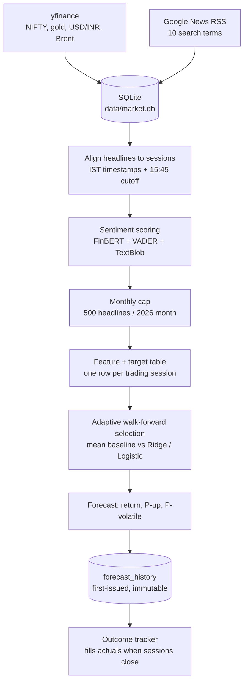
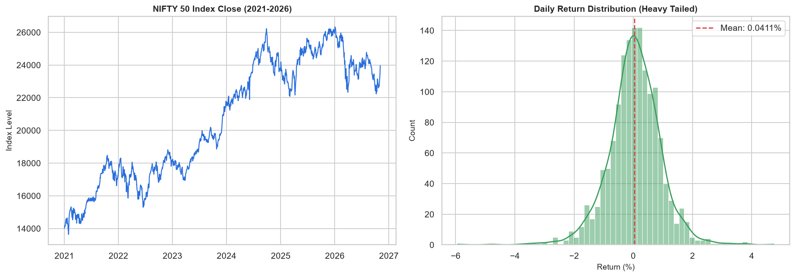
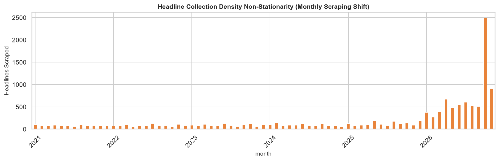
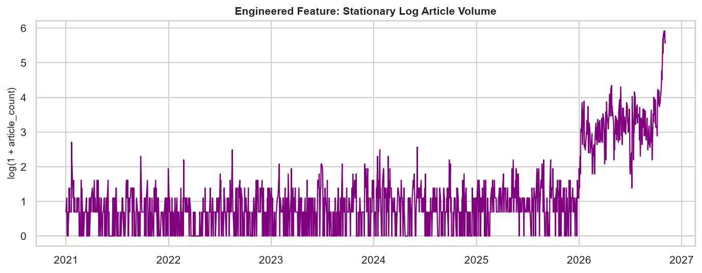
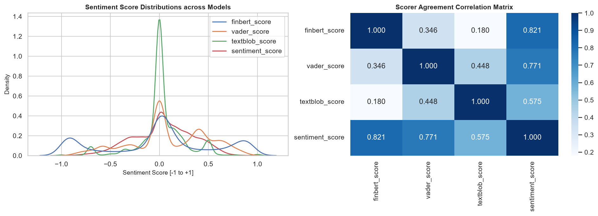
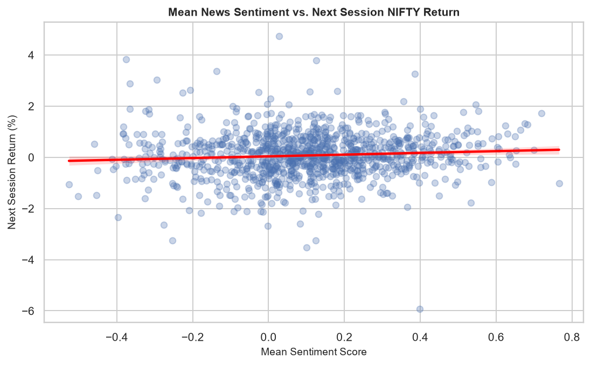

# Finance-IDC — Does News Sentiment Help Forecast the NIFTY 50?

An end-to-end, reproducible data-science pipeline that scrapes financial headlines and market prices, aligns them in time, scores sentiment, builds features, and tests — with strict chronological validation — whether news adds any information about the **next NIFTY 50 trading session**.

> **Course:** IDC409, Topic 3 — Web Scraping I (Finance + News) · **Repo:** <https://github.com/SVDKWTD/finance-IDC>
>
> **Honest headline result:** the pipeline runs end to end and the engineering is sound, but **news sentiment does not improve next-session return or direction forecasts**. Models are slightly *worse* than a constant mean baseline. The one component with measurable (modest) skill is a **volatility** classifier (ROC-AUC ≈ 0.65). Nothing here is investment advice.

---

## Contents

1. [Results at a glance](#1-results-at-a-glance)
2. [Workflow overview](#2-workflow-overview)
3. [Data sources and snapshot](#3-data-sources-and-snapshot)
4. [Stage-by-stage workflow](#4-stage-by-stage-workflow)
5. [Data cleaning rules](#5-data-cleaning-rules)
6. [Algorithms and models used](#6-algorithms-and-models-used)
7. [Validation protocol](#7-validation-protocol)
8. [Exploratory data analysis — key findings](#8-exploratory-data-analysis--key-findings)
9. [Model results](#9-model-results)
10. [Known issues and caveats](#10-known-issues-and-caveats)
11. [Repository structure](#11-repository-structure)
12. [Setup and usage](#12-setup-and-usage)
13. [Generated files reference](#13-generated-files-reference)
14. [Team and disclaimer](#14-team-and-disclaimer)

---

## 1. Results at a glance

| Question | Answer | Evidence |
|---|---|---|
| Can we predict next-session **return** better than the historical mean? | **No.** Ridge models are slightly worse (MAE 0.628–0.630 vs 0.619; R² < 0). | Walk-forward, 433 forecasts |
| Can we predict **direction** (up/down)? | **No.** Accuracy 47–48% vs 50.8% majority class; probabilities not calibrated. | Same |
| Does **sentiment** relate to the *next* day's return? | **No** (r ≈ 0.02, p ≈ 0.36). It *does* mirror the **same** day's return (r ≈ 0.20) — headlines describe what just happened. | EDA Part I |
| Can we predict a **volatile** session (unusually large \|return\|)? | **Modestly.** ROC-AUC 0.65 (95% CI ≈ 0.56–0.73), Brier 0.149 vs 0.162 baseline — but skill is concentrated in one of three time slices. | EDA Part K |
| Are there data problems that limit conclusions? | **Yes** — see [§10](#10-known-issues-and-caveats): placeholder timestamps, a 5–10× change in headline density, blended asset news. | EDA Parts C, G |


*Left: cumulative extra error versus the mean baseline (above 0 = worse). Middle: predictions are tiny versus actual returns and uncorrelated with them. Right: predicted probabilities do not track observed frequencies.*

---

## 2. Workflow overview



`run_pipeline.py` runs these nine steps in order and stops on the first failure:

| # | Script | Purpose |
|---|---|---|
| 1 | `src/collect_prices.py` | Incrementally download NIFTY / gold / USD-INR / Brent (7-day overlap) |
| 2 | `src/collect_recent_news.py` | Rolling 7-day Google News RSS collection, de-duplicated by URL |
| 3 | `src/import_collected_data.py` | Validate and upsert news and prices into SQLite |
| 4 | `src/align_news_market.py` | Assign every headline to the session it may inform; build daily table + target |
| 5 | `src/analyze_news_sentiment.py` | Score new headlines (cached), aggregate daily sentiment |
| 6 | `src/build_model_dataset.py` | Research-only comparison dataset (see [§13](#13-generated-files-reference)) |
| 7 | `src/build_monthly_sampled_dataset.py` | **Official** model input: monthly-capped sentiment |
| 8 | `src/generate_forecast.py` | Adaptive model selection → forecast → persist in SQLite |
| 9 | `src/record_forecast_outcome.py` | Resolve pending forecasts against realised prices |

---

## 3. Data sources and snapshot

| Source | Tool | Used for |
|---|---|---|
| NIFTY 50 (`^NSEI`), gold (`GC=F`), USD/INR (`INR=X`), Brent (`BZ=F`) | `yfinance` | Prices, returns, targets |
| Financial headlines | Google News RSS via `feedparser` + `requests` | Sentiment and news-volume features |
| `ProsusAI/finbert` | Hugging Face `transformers` | One of three sentiment scorers |
| VADER, TextBlob | `vaderSentiment`, `textblob` | The other two scorers |
| Local store | SQLite (`data/market.db`) | Prices, headlines, forecast history |

**Search terms** (identical for historical and recent collection): *India stock market, Sensex, NIFTY 50, Indian economy, RBI India, Indian stock market earnings, India inflation interest rates, Reliance Industries earnings, Tata Consultancy Services earnings, NSE BSE market news.*

**Snapshot used for every number in this README** (last completed session 2026-11-03):

| | |
|---|---|
| NIFTY sessions | 1,442 (2021-01-01 → 2026-11-03) |
| Raw headlines | 13,520 (5,581 for 2021–2025, with four market tags; 7,939 for 2026) |
| Unique headlines scored | 13,083 from 780 distinct sources (13,485 unique URLs) |
| Sessions with zero headlines | 26 (all before 2026) |
| Stored forecasts | 13 rows; 4 from the current official model version |

> **Why free sources?** The project's rule is "free-only" (see `decisions.md`). Google News RSS replaced NewsAPI/GDELT; `yfinance` replaced Alpha Vantage. The trade-off is incomplete and un-versioned news coverage.

---

## 4. Stage-by-stage workflow

### 4.1 Price collection — `collect_prices.py`
Downloads daily bars (`auto_adjust=False`) from 2021-01-01. For each asset it **re-downloads the last 7 days** and keeps the newest row per date, so late revisions overwrite stale values; only completed calendar dates are kept.

### 4.2 News collection — `backfill_historical_news.py`, `collect_recent_news.py`
* **Historical (2021–2025):** one query window per calendar month × 10 search terms.
* **Recent (2026→):** a rolling 7-day window × 10 terms; results merged with everything saved, de-duplicated by URL, and checked against the historical file.
* Each row stores `title, published_at (UTC), source, url, matched_terms, requested_month, collected_at`. A 3-second pause separates requests.

### 4.3 Database import — `import_collected_data.py`, `db.py`
Rows are validated (non-blank URL/title, parseable timestamp), de-duplicated and **upserted** with `UNIQUE(url, market)` / `UNIQUE(ticker, date)`. `db.py` migrates older schemas in place without losing rows.

### 4.4 News → market-session alignment — `align_news_market.py`
Timestamps are converted to **IST**. Each headline is mapped to the **first NIFTY session whose cutoff is at or after the moment the information became available**:

| Market tag | Cutoff (IST) | Effect |
|---|---|---|
| `nifty` | 15:45 (15 min after the 15:30 close) | before → same session; after → next session |
| `usd_inr` | 17:00 | same-day headlines → next session |
| `gold`, `brent` | 00:00 | same-day headlines → next session |

Weekend and holiday headlines roll to the next trading session. Implemented with two chained `numpy.searchsorted` calls; the EDA re-implements it with `pandas.merge_asof` and agrees on **100% of 13,118 headlines**.

The target is built here: `target_next_session_return_pct = daily_return_pct.shift(-1)`.

### 4.5 Sentiment — `analyze_news_sentiment.py`
Each unique headline gets three scores on [−1, 1]; the **ensemble is their equal-weight mean**:

```text
finbert_score   = P(positive) − P(negative)        # ProsusAI/finbert, max_length 512, batch 32
vader_score     = VADER compound
textblob_score  = TextBlob polarity
sentiment_score = (finbert_score + vader_score + textblob_score) / 3
label           = positive if > 0.05 · negative if < −0.05 · neutral otherwise
```
Scores are **cached by URL** (fallback key: casefolded title + timestamp) and tagged `scoring_version = finbert_vader_textblob_v1`, so only new headlines are re-scored and a method change invalidates old scores.

Daily aggregates per session: `article_count, mean/median sentiment, positive/negative/neutral fractions` (+ per-scorer means).

### 4.6 The official dataset — monthly cap
`monthly_sampling_experiment.sample_articles()` keeps **all 2021–2025 headlines** and randomly caps **each 2026 month at 500** (without replacement, `random_state = 42 + month ordinal`). Counts, unique sources and every sentiment statistic are **recomputed from the capped sample**. Output: `model_dataset_sampled_monthly_2026.csv`.

### 4.7 Features and targets — `generate_forecast.add_features`

| Group | Features |
|---|---|
| Market (7) | `daily_return_pct`, `return_lag1/2/5`, `volatility_5`, `article_count`, `unique_sources` |
| + Sentiment (12) | market features + `mean_sentiment`, `positive/negative/neutral_fraction`, `sentiment_lag1` |
| Volatility (16) | returns (lags 1, 2, 5, 10), `volatility_5/20`, `momentum_5/10`, counts, mean/median sentiment, fractions |

| Task | Target | Model |
|---|---|---|
| Return | r(t+1) = 100·(P(t+1)/P(t) − 1) | Ridge |
| Direction | 1[r(t+1) > 0] | Logistic regression |
| Volatile session | 1[ \|r(t+1)\| > 80th percentile of \|r\| over the last 252 sessions (min 60) ] | Logistic regression |

### 4.8 Forecast, persistence and outcome tracking
`generate_forecast.py` stores the forecast in `forecast_history` with `ON CONFLICT(forecast_origin_date, model_version) DO NOTHING`, so **the first-issued forecast for a date and model is immutable** — results cannot be rewritten after the outcome is known. Re-running the pipeline refreshes `latest_forecast.csv` only. `record_forecast_outcome.py` later fills actual return, direction and whether the volatility threshold was exceeded.

---

## 5. Data cleaning rules

The complete step-by-step demonstration, with row counts and equality checks against the pipeline's files, is in the EDA notebook (Parts A, C, D).

| Dataset | Problem found | Rule |
|---|---|---|
| NIFTY prices | Last row has no `Close`, `Volume = 0` (incomplete day) | Drop rows without a valid `Close`; drop `Close ≤ 0` |
| | Duplicate dates after overlapping downloads | Sort, keep newest per `Date` |
| | Adjusted close split over `Adj_Close` / `Adj Close` | Single `Adj_Close` (= `Close` for an index) |
| | 12 sessions with `Volume = 0` | Kept; volume is not a model input |
| | — | Derive `Daily_Return(_Pct)`, `Daily_Range`, `Intraday_Change_Pct` |
| External series | Missing on non-shared holidays (≈3% of sessions for gold/Brent) | Forward-fill the *return* (note: repeats the prior return) |
| Headlines | Same article returned by several queries (35 URL duplicates in the historical file) | De-duplicate by URL, merge `matched_terms` |
| | Blank title/URL or unparseable timestamp | Dropped (none present in this snapshot) |
| | Mixed timestamp formats | `to_datetime(..., utc=True, format="mixed")` |
| | Titles all end with `- Source` (Google News format) | Left in place (sent to the sentiment models) |
| Sentiment | Sessions with no headline | `article_count = 0`, sentiment left missing |
| Model table | Lags/rolling windows, no-news sessions | Median imputation + standardisation **inside** each training window |

Return definition used everywhere: `r(t) = 100·(P(t)/P(t−1) − 1)`, with `P(t−1)` the previous **trading** session (no zero-return weekends).

---

## 6. Algorithms and models used

| Purpose | Algorithm | Settings | Where |
|---|---|---|---|
| Return forecast | **Ridge regression** | `alpha = 10`, `SimpleImputer(median)` → `StandardScaler` → `Ridge` | `generate_forecast.py`, `adaptive_model_selection.py` |
| Direction forecast | **Logistic regression** | `max_iter = 1000`, `random_state = 42` | same |
| Volatility forecast | **Logistic regression** | `max_iter = 2000`; spec frozen before prospective evaluation | `generate_forecast.py` |
| Baselines | Expanding **mean return**; majority class; training prevalence | — | everywhere |
| Sentiment | **FinBERT** (BERT fine-tuned on financial text), **VADER** (lexicon/rules), **TextBlob** (pattern polarity) | equal-weight average, ±0.05 label band | `analyze_news_sentiment.py` |
| Model selection | **Adaptive walk-forward** (below) | 2-month window, ≥ 30 predictions, 2% MAE margin | `adaptive_model_selection.py` |
| Sampling | Monthly cap (random, seeded) · alt: daily "representative sample" (1,000 draws of 20; keep the draw whose mean is closest to the mean of draws) | cap 500 | `monthly_sampling_experiment.py`, `sample_news_sentiment.py` |
| Algorithm comparison | Linear, Ridge, Decision Tree (depth 5, leaf 10), Random Forest (200 trees), SVR/SVC (RBF, C = 1) | chronological split | `model_comparison.py` |
| Dimensionality reduction | **PCA** (2–10 components) before Ridge/Logistic; component count chosen on a development period only | — | `pca_experiment.py`, `controlled_validation.py` |
| Feature experiments | Ablation (drop one feature/group), momentum / volatility-regime / news-dynamics features | — | `feature_ablation.py`, `new_feature_experiment.py` |
| Inference | Pearson/Spearman, Welch t-test, exact McNemar, Wilson intervals, binomial test, **circular moving-block bootstrap** (block 5) | 10,000 resamples | `statistical_significance.py`, `test_sentiment_significance.py` |

### Adaptive model selection (runs inside every forecast)
1. Take the **most recent two calendar months** of completed targets as an out-of-sample window.
2. For each session in it, refit using **only earlier rows**, with two window modes: *expanding* and *rolling 252 sessions*.
3. **Return:** a feature model is chosen only if it has ≥ 30 recent predictions **and** its MAE is ≥ 2% below the expanding mean baseline; otherwise the **baseline** is used.
4. **Direction:** lowest Brier score among eligible classifiers (market vs. market+sentiment, each window mode).
5. Choices and diagnostics go to `adaptive_model_selection.csv/.json`.

This is periodic re-selection, not online learning. See [§10](#10-known-issues-and-caveats) on its instability.

---

## 7. Validation protocol

* **Never shuffle.** Every split is chronological.
* **Walk-forward (expanding):** start after 70% of rows; for session *i*, fit on rows `0…i−1`, predict, advance one session.
* **All preprocessing inside the fold.** Imputer and scaler are part of the scikit-learn `Pipeline`, so they never see the test row.
* **Compare against baselines on identical dates**: expanding mean (returns), majority class / 0.5 (direction), training prevalence (volatility).
* **Metrics:** MAE, RMSE, R² (returns); accuracy, Brier score, high-confidence accuracy (direction); ROC-AUC, Brier, calibration (volatility); block-bootstrap intervals for differences.
* **Prospective record:** forecasts are written *before* the outcome exists and never overwritten.

---

## 8. Exploratory data analysis — key findings

The full analysis — **every distribution, every cleaning step, and every assumption check** — is in [`notebooks/Finance_IDC_EDA.ipynb`](notebooks/Finance_IDC_EDA.ipynb) (108 cells, executed, read-only on `data/`). Highlights:

### Returns are noise-dominated and heavy-tailed; volatility is structured
Daily mean ≈ +0.04%, std ≈ 0.89%, excess kurtosis ≈ 3.6, lag-1 autocorrelation ≈ 0 — but absolute returns are strongly autocorrelated (lag-1 ≈ 0.23; Ljung–Box p ≈ 10⁻⁴⁹).




### ~97% of headline timestamps are date-only placeholders
Almost every 2021–2025 timestamp (and 97–100% of 2026's before mid-October) is exactly **midnight US-Pacific time** — Google News returns a date, not a clock time, for older items. The 15:45 IST cutoff therefore acts on only **~22% of headlines**; the rest are aligned by calendar date.


### Headline density jumps by an order of magnitude in 2026
~4–6 headlines per session in 2021–2025 versus ~24 (peaks above 200) in 2026, because the rolling collector retrieves far more per day than month-wide queries did. `article_count` / `unique_sources` are therefore largely a **collection-regime indicator** (KS statistic ≈ 0.82 between periods; recent sessions sit 20–100 standard deviations above the 2021–2025 mean).




### Sentiment: three disagreeing scorers, no forecasting power
* Scorers correlate only weakly (FinBERT–VADER 0.34, FinBERT–TextBlob 0.18, VADER–TextBlob 0.45); FinBERT calls 51% of headlines neutral, the ensemble only 19%.
* Sentiment vs the **next** session's return: r ≈ 0.02 (p ≈ 0.36), sign flips between years. Versus the **same** session's return: r ≈ 0.20 — headlines *report* the move.




### Alignment logic verified; leakage audit passes
The independent re-implementation matches all 13,118 headlines; target/lag construction passes seven automated checks; no feature has |corr| above 0.05 with the target. Two residual caveats remain (date-level timing; month-wise cap) — see §10.

---

## 9. Model results

All figures are from the 2026-11-03 snapshot and were **re-computed** in the EDA notebook using the project's own `evaluate_dataset`.

### Walk-forward return and direction (433 forecasts, 2025-01-30 → 2026-11-02)

| Model | MAE (pp) | RMSE (pp) | R² |
|---|---:|---:|---:|
| **Expanding mean baseline** | **0.6192** | **0.8376** | −0.0029 |
| Ridge: market + news volume | 0.6277 | 0.8471 | −0.0257 |
| Ridge: market + news volume + sentiment | 0.6300 | 0.8507 | −0.0345 |

| Direction model | Accuracy | Brier |
|---|---:|---:|
| Constant 0.5 forecast | — | 0.2500 |
| Market + news volume | 47.1% | 0.2567 |
| + sentiment | 47.8% | 0.2581 |

Majority-class accuracy is 50.8%. The block-bootstrap 95% interval for the models' *extra* error versus the baseline is roughly +0.002 to +0.018 pp — entirely above zero. Rank correlation between predictions and outcomes is −0.04 / −0.06 (p = 0.45 / 0.24). High-confidence forecasts (n = 20 and 37) were right only 20% and 32% of the time.

### Other experiments (saved outputs in `data/processed/`)

| Experiment | Result |
|---|---|
| 6 algorithms (Linear, Ridge, Tree, Forest, SVR) | All have higher MAE than the baseline (0.617): Ridge 0.634, Forest 0.642, Tree 0.650, SVR 0.660 |
| Classifiers | Logistic 52.0% (Brier 0.260), Forest 50.6%, SVC 48.7%, Tree 45.5%; majority class 49.2% |
| Feature ablation / new features | No variant beats the mean baseline on MAE |
| PCA (2 components) | Best Brier on development and hold-out (0.2506 vs 0.2563 full), but the block-bootstrap interval for the improvement includes 0 ([−0.0006, +0.0117]) |
| Sampling (full vs monthly-capped) | Essentially identical metrics — the cap does not change conclusions |

### Volatility classifier (413 sessions, 2025-02-19 → 2026-10-26)

| | Model | Prevalence baseline |
|---|---:|---:|
| ROC-AUC | **0.651** (block-bootstrap 95%: 0.56–0.73) | 0.476 |
| Brier | **0.1493** | 0.1624 |

Persistence explains it: after a volatile session the chance of another is ≈ 30% versus ≈ 17% after a calm one. But skill varies by period — Brier improvement over baseline is +0.002, **+0.038**, and −0.001 across three consecutive slices — so treat it as a **research lead**. The 20% / 30% alert levels are informational and must not be tuned on prospective outcomes.


### Prospective record
Only 3 official forecasts have been evaluated so far (all up days; the selected direction model was right 3/3). Always guessing "up" gets 3/3 about 12.5% of the time by luck, so **this record is too short to support any conclusion**.

---

## 10. Known issues and caveats

Items 1–2 are concrete pipeline defects with small fixes; the rest are limitations of the data and design. All were verified against the code and files in this snapshot.

| # | Issue | Impact | Suggested fix |
|---|---|---|---|
| 1 | **2026 headlines are imported as `unclassified`.** `recent_news_2026.csv` has no `market` column; `align_news_market.py` deliberately skips unclassified rows. The database still holds older copies tagged `nifty`, which hides the problem — but **174 URLs (Oct 30 → Nov 4) exist only as `unclassified` and are excluded**, and every future collected headline will be too. | Silent data loss that grows each run | In `import_collected_data.load_news_files`, default `market = "nifty"` for the 2026 file |
| 2 | **`nifty50_processed.csv` is not produced by any script in `src/`.** `collect_prices.py` writes only raw CSVs; `import_collected_data.py` and `record_forecast_outcome.py` read the processed file (with `Daily_Return_Pct`, etc.). `process_data.py` / `clean.py` write different column names and are not in the pipeline. | A fresh clone cannot refresh prices end to end | Add a step that applies the cleaning in EDA §4 (reproduces the file exactly) |
| 3 | **Date-only timestamps.** ~78% of headlines carry a midnight-Pacific placeholder instead of a publication time. | Training uses date-level timing, live forecasting minute-level timing | Store true timestamps going forward; evaluate the 15:45 rule only where times are real |
| 4 | **Non-stationary news volume.** Headline counts jump ~5× in 2026 and are 20–100 SDs out of range for the newest sessions. Stored live forecasts for 2026-11-02 (+1.94%, P(up) 96.9%) and 11-03 (+0.92%, 84.4%) lie far outside the backtest range (−0.26% … +0.46%; P(up) 0.23–0.65). | Linear models extrapolate; live probabilities are unreliable | Use rates / log-winsorised counts, or drop raw counts |
| 5 | **Daily "NIFTY sentiment" blends asset tags before 2026** (31% NIFTY, 29% gold, 26% Brent, 14% USD/INR). | Oil/gold headlines move the NIFTY feature | Aggregate NIFTY-tagged headlines only |
| 6 | **Monthly cap is calendar-month based.** A partial month packs up to 500 headlines into a few sessions (November: ~250 per session), and a session's sample depends on later days' volume. | Current-month features are not final | Cap per day |
| 7 | **Adaptive selector is unstable.** The stored 2026-11-03 record selected *sentiment* for both tasks; the regenerated JSON (same date, 41 points) selects *baseline* / *market*. | Selection from ~40 noisy points is a heuristic | Treat as advisory |
| 8 | **Headline-level de-duplication is URL only** (3.3% of rows share an exact title with a different URL). | Mild over-weighting of syndicated stories | De-duplicate on normalised title + date |
| 9 | **Setup files incomplete.** `environment.yml` omits `torch`, `transformers`, `textblob`, `scipy`; the repo has no `requirements.txt`. | Fresh installs fail at sentiment scoring | Use the `requirements.txt` provided with this README |
| 10 | **Docs drift.** `context.md` / `decisions.md` describe sentiment as FinBERT-only and a 15:30 cutoff; the code uses the 3-scorer ensemble and 15:45. `model_dataset.csv` is built from the *daily-sampled* sentiment file, not the full corpus as some notes say. | Confusion when writing the report | This README reflects the code |
| 11 | **`data/` is large.** `market.db` is ~82 MB (plus a same-size backup). `decisions.md` says `data/` is git-ignored but the committed `.gitignore` does not list it. | GitHub size limits | Check `git status` before committing; add `data/` to `.gitignore` |

**Other limitations:** headline-only sentiment; Google News is a sample, not a census; futures series may contain contract-roll jumps; no transaction costs, slippage or position sizing; no causal claim is made.

---

## 11. Repository structure

```text
finance-IDC/
├── run_pipeline.py              # runs the 9 routine stages
├── requirements.txt             # dependencies (added with this README)
├── environment.yml              # conda env (incomplete — see §10)
├── README.md
├── context.md · decisions.md · PIPELINE_GUIDE.md · INTEGRATION_NOTES.md · Contributions.txt
│
├── src/
│   ├── collect_prices.py · collect_recent_news.py · backfill_historical_news.py
│   ├── import_collected_data.py · db.py
│   ├── align_news_market.py · analyze_news_sentiment.py
│   ├── build_model_dataset.py · build_monthly_sampled_dataset.py · monthly_sampling_experiment.py
│   ├── generate_forecast.py · adaptive_model_selection.py · record_forecast_outcome.py
│   └── experiments / audits (not run by the pipeline):
│       model_comparison · feature_ablation · pca_experiment · new_feature_experiment
│       controlled_validation · statistical_significance · test_sentiment_significance
│       volatility_forecast_experiment · validate_volatility_experiment · prospective_volatility_forecast
│       audit_database · audit_historical_news · validate_historical_data · check_dataset_alignment
│
├── notebooks/
│   ├── Finance_IDC_EDA.ipynb    # full EDA + cleaning walkthrough (this README's source of numbers)
│   └── (older exploratory notebooks)
│
├── reports/figures/             # figures saved by the EDA notebook
└── data/
    ├── raw/                     # as collected
    ├── processed/               # aligned, scored, modelled
    └── market.db                # SQLite store + forecast_history
```

---

## 12. Setup and usage

### Requirements
Python 3.10+ (3.12 used). The first sentiment run downloads FinBERT (several hundred MB) from Hugging Face and runs on CPU or CUDA automatically.

```bash
git clone https://github.com/SVDKWTD/finance-IDC.git
cd finance-IDC

python -m venv .venv && source .venv/bin/activate      # Windows: .venv\Scripts\activate
pip install -r requirements.txt
```
(`conda` users: create a Python 3.12 environment, then `pip install -r requirements.txt`.) If PyTorch needs a specific CPU/CUDA build, install it first from <https://pytorch.org>.

### Run the pipeline
Run from the **repository root** (scripts use relative `data/` paths):

```bash
python run_pipeline.py
```
It prints each stage, stops on the first failure, and finally lists the official outputs. To run one stage: `python src/<script>.py`. `run_pipeline.py` has no command-line options.

### Re-create the EDA
```bash
jupyter lab notebooks/Finance_IDC_EDA.ipynb      # Run All (~1 minute)
```
The notebook only reads `data/`, imports `add_features` and `evaluate_dataset` from `src/`, and writes figures to `reports/figures/`. `statsmodels` is optional (one stationarity test is skipped without it).

### Reading a forecast
`data/processed/latest_forecast.csv` contains, for the latest origin session: the market-only and market+sentiment return forecasts and P(up); the adaptively selected return/direction model; the volatility probability, its threshold and the 20% / 30% alert flags; and a list of warnings. **Predicted returns are near the historical mean by design — the evidence above says to treat them as such.**

---

## 13. Generated files reference

| File (`data/processed/`) | Description |
|---|---|
| `nifty50_processed.csv` | Cleaned NIFTY prices and returns |
| `news_market_alignment.csv` | Headline → `feature_date`, with cutoff used |
| `news_sentiment_scored.csv` | Headline-level scores and labels |
| `news_sentiment_daily.csv` | Daily sentiment (full corpus, all asset tags) |
| `news_market_daily.csv` | Daily prices, per-market counts, external returns, target |
| `news_sentiment_sampled_monthly_2026.csv`, `…daily_sampled_monthly_2026.csv` | Monthly-capped articles and daily aggregates |
| **`model_dataset_sampled_monthly_2026.csv`** | **Official model input** |
| `model_dataset.csv` | Research-only comparison dataset (daily-sampled sentiment) |
| `adaptive_model_selection.csv/.json` | Recent-window metrics and the selected configuration |
| **`latest_forecast.csv`** | Latest freshly computed official forecast |
| `forecast_outcome_history.csv` | Evaluated prospective outcomes |
| `walk_forward_*`, `model_comparison_*`, `pca_*`, `feature_ablation_*`, `volatility_*` | Saved experiment results |

SQLite (`data/market.db`) tables: `market_prices`, `news` (`UNIQUE(url, market)`), `forecast_history` (`UNIQUE(forecast_origin_date, model_version)`).

---

## 14. Team and disclaimer

**Team contributions** (from `Contributions.txt`)

* **Khushi** — data collection from `yfinance` and Google News RSS
* **Parth** — SQLite storage, alignment, sentiment analysis
* **Suryansh** — feature engineering, dataset training, walk-forward evaluation, volatility
* **Together** — final forecasting: capping the data, the adaptive walk-forward algorithm, and comparing data-alignment/usage choices

**Disclaimer.** This is an academic project. It does not provide financial advice, and its forecasts must not be used as the basis for investment or trading decisions. Findings describe one data snapshot and may change when data is refreshed.
