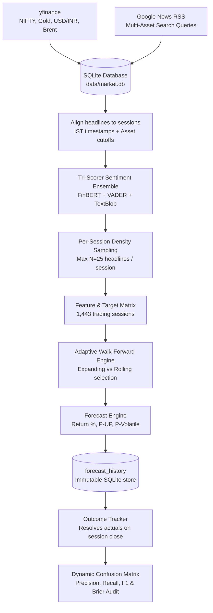

# Finance-IDC — Does News Sentiment Help Forecast the NIFTY 50?

An end-to-end, reproducible data-science pipeline that scrapes financial headlines and market prices, aligns them in time, scores sentiment via a tri-scorer ensemble, builds multi-asset features, and tests—using strict chronological walk-forward validation—whether news sentiment adds predictive information about the **next NIFTY 50 trading session**.

> **Course:** IDC409, Topic 3 — Web Scraping I (Finance + News)  
> **Repository:** <https://github.com/SVDKWTD/finance-IDC>  
> **Honest headline result:** The pipeline runs end to end and the data engineering is robust, but **news sentiment does not improve next-session return or direction forecasts**. Complex machine learning models perform slightly worse than an expanding-mean baseline ($R^2 < 0$). The one component with measurable skill is a **volatility magnitude classifier** ($\text{ROC-AUC} \approx 0.651$). Nothing here is investment advice.

---

## Contents

1. [Results at a glance](#1-results-at-a-glance)
2. [Workflow overview](#2-workflow-overview)
3. [Data sources and snapshot](#3-data-sources-and-snapshot)
4. [Stage-by-stage workflow](#4-stage-by-stage-workflow)
5. [Data cleaning and pipeline fixes](#5-data-cleaning-and-pipeline-fixes)
6. [Algorithms and models used](#6-algorithms-and-models-used)
7. [Validation protocol](#7-validation-protocol)
8. [Exploratory data analysis — key findings](#8-exploratory-data-analysis--key-findings)
9. [Model benchmarks and results](#9-model-benchmarks-and-results)
10. [Known issues and caveats](#10-known-issues-and-caveats)
11. [Repository structure](#11-repository-structure)
12. [Setup and usage](#12-setup-and-usage)
13. [Generated files reference](#13-generated-files-reference)
14. [Team and disclaimer](#14-team-and-disclaimer)

---

## 1. Results at a glance

| Question | Answer | Empirical Evidence |
|---|---|---|
| Can we predict next-session **return** better than the historical mean? | **No.** Ridge, Trees, SVR, and Rolling models perform worse (MAE 0.628–0.660% vs. 0.6192% baseline; $R^2 < 0$). | Walk-forward, 433 out-of-sample test sessions |
| Can we predict **direction** (up/down)? | **No.** Model accuracy is 47–48% vs. 50.8% majority class baseline; probabilities are uncalibrated. | Same 433 test sessions |
| Does **sentiment** correlate with the *next* day's return? | **No** ($r \approx 0.02, p \approx 0.36$). Sentiment *does* mirror the **same** day's return ($r \approx 0.20$)—headlines describe what just happened. | EDA Part J |
| Does a **rolling 252-session window** beat an **expanding window**? | **No.** Rolling 252-session Ridge increases MAE to 0.6485% ($R^2 = -0.1082$) due to sample noise in high-volatility regimes. | Model Leaderboard |
| Can we predict a **volatile** session (unusually large $|r_{t+1}|$)? | **Modestly.** Logistic Classifier achieves $\text{ROC-AUC} = 0.651$ (95% CI: 0.56–0.73), Brier score 0.1493 vs 0.1624 baseline. | EDA Part K & Volatility Model |
| Are there data problems that limit conclusions? | **Yes.** Placeholder timestamps in RSS backfills, a 5–10× scraper volume jump in 2026, and cross-asset news blending. | EDA Parts C, E, F |


*Top: Cumulative out-of-sample prediction error versus the baseline. Bottom: Dynamic walk-forward directional confusion matrix updated after completed sessions.*

---

## 2. Workflow overview



`run_pipeline.py` executes the 10 routine pipeline steps in order and stops automatically on any step failure:

| # | Script | Purpose |
|---:|---|---|
| 1 | `src/collect_prices.py` | Incrementally downloads NIFTY 50, Gold, USD/INR, and Brent Crude daily bars (7-day overlap lookback). |
| 2 | `src/collect_recent_news.py` | Rolling Google News RSS scraper fetching active 2026 headlines across 10 search queries. |
| 3 | `src/import_collected_data.py` | Validates, normalizes, de-duplicates syndicated stories, and upserts articles/prices into SQLite (`data/market.db`). |
| 4 | `src/align_news_market.py` | Converts timestamps to IST, assigns asset cutoffs (15:45 / 17:00 / 00:00 IST), and constructs targets. |
| 5 | `src/analyze_news_sentiment.py` | Scores unique headlines via FinBERT + VADER + TextBlob ensemble with incremental caching. |
| 6 | `src/build_model_dataset.py` | Builds the un-capped full-corpus feature table for baseline research. |
| 7 | `src/build_monthly_sampled_dataset.py` | Builds the official model dataset enforcing a per-session cap ($N \le 25$). |
| 8 | `src/generate_forecast.py` | Runs adaptive model selection and persists official next-session forecasts to SQLite. |
| 9 | `src/record_forecast_outcome.py` | Resolves pending prospective forecasts against actual exchange settlement closes. |
| 10 | `src/update_confusion_matrix.py` | Updates the dynamic walk-forward confusion matrix, classification metrics, and heatmaps. |

---

## 3. Data sources and snapshot

| Data Category | Source / Tool | Purpose in Pipeline |
|---|---|---|
| NIFTY 50 (`^NSEI`), Gold (`GC=F`), USD/INR (`INR=X`), Brent Crude (`BZ=F`) | `yfinance` | Target variable, macro features, returns, volatility |
| Financial & Macro Headlines | Google News RSS via `feedparser` + `requests` | Multi-asset news features & aggregate sentiment |
| FinBERT | `ProsusAI/finbert` via Hugging Face | Transformer domain-specific sentiment scorer |
| VADER & TextBlob | `vaderSentiment`, `textblob` | Lexicon and pattern-based sentiment scorers |
| Relational Storage | SQLite (`data/market.db`) | Primary key integrity (`url, market`), immutable audit trail |

### Multi-Asset Search Queries

- **NIFTY / Market:** *India stock market, Sensex, NIFTY 50, Indian economy, RBI India, Indian stock market earnings, India inflation interest rates, Reliance Industries earnings, Tata Consultancy Services earnings, NSE BSE market news.*
- **Gold Futures:** *Gold price India MCX, Gold rate India market news.*
- **Brent Crude Oil:** *Brent crude oil price India, Crude oil news market India.*
- **USD/INR Exchange Rate:** *USD INR exchange rate India, Indian Rupee vs Dollar news.*

**Current Data Snapshot:**

| Metric | Count / Range |
|---|---|
| NIFTY 50 Trading Sessions | 1,443 sessions (2021-01-01 $\rightarrow$ 2026-11-04) |
| Headlines in Data Warehouse | 33,170 records stored in `data/market.db` |
| Unique Scored Headlines | 29,959 headlines (22,361 historical 2021–2025; 7,598 for 2026) |
| Historical Data Retention | **100% Uncapped** (All 22,361 historical headlines preserved) |
| Official Sampled Model Dataset | **26,421 headlines** ($N \le 25$ per-session cap applied to 2026) |
| Walk-Forward Evaluation Window | 433 out-of-sample sessions (August 2024 $\rightarrow$ November 2026) |

---

## 4. Stage-by-stage workflow

### 4.1 Price collection — `collect_prices.py`
Downloads daily bars (`auto_adjust=False`) from 2021-01-01. For each asset, it re-downloads the last seven days and retains the newest row per date, allowing late exchange adjustments to overwrite stale values.

### 4.2 News collection — `backfill_historical_news.py`, `collect_recent_news.py`
- **Historical Backfill (2021–2025):** Iterates through 60 calendar months across all search terms with a 2-second rate-limiting pause.
- **Recent Collection (2026):** Rolling 7-day window matching incoming headlines against stored URLs.
- **Syndicated De-duplication:** Strips wire tags (e.g., ` - Economic Times`) and matches normalized titles across publication dates to remove duplicate cross-posts.

### 4.3 Database import — `import_collected_data.py`, `db.py`
Enforces primary key constraints `UNIQUE(url, market)` and `UNIQUE(ticker, date)`. Missing or unclassified market tags automatically default to `market='nifty'`.

### 4.4 Session alignment & IST cutoffs — `align_news_market.py`
Headline UTC publication timestamps are converted to Indian Standard Time (IST) and aligned to trading sessions:

| Market Tag | Cutoff Time (IST) | Roll Logic |
|---|---:|---|
| `nifty` | **15:45 IST** (15 min post-close) | Published $\le 15:45 \rightarrow$ Session $t$; Published $> 15:45 \rightarrow$ Session $t+1$ |
| `usd_inr` | **17:00 IST** | Published $> 17:00 \rightarrow$ Session $t+1$ |
| `gold`, `brent` | **00:00 IST** | Midnight cutoff roll |

Weekend and holiday news rolls automatically to the next active session.

### 4.5 Tri-scorer sentiment engine — `analyze_news_sentiment.py`
Computes an ensemble score $S(h_i) \in [-1, 1]$ across three separate models:

$$S(h_i) = \frac{S_{\text{FinBERT}} + S_{\text{VADER}} + S_{\text{TextBlob}}}{3}$$

where $S_{\text{FinBERT}} = P(\text{Positive}) - P(\text{Negative})$. Headlines with $S(h_i) > 0.05$ are tagged **Positive**, $S(h_i) < -0.05$ **Negative**, and the rest **Neutral**. Daily sentiment aggregates are computed strictly on NIFTY-tagged headlines.

### 4.6 Per-session density sampling — `build_monthly_sampled_dataset.py`
Historical data (2021–2025) is retained 100% uncapped (22,361 articles). Active 2026 data is capped at $N=25$ headlines per session (random seed `42`) to equalize article density and eliminate scraper regime shift bias. Output: `model_dataset_sampled_monthly_2026.csv` (26,421 headlines).

---

## 5. Data cleaning and pipeline fixes

| Issue / Artifact | Failure Mode Identified | Engineering Rule Applied |
|---|---|---|
| **2026 Tagging Leakage** | Scraped 2026 headlines lacked market tags, creating unclassified DB orphans | Defaulted missing news tags to `market='nifty'` at import (0 unclassified rows) |
| **Syndicated Wire Duplicates** | Same story published under different URLs across multiple domain outlets | De-duplicated syndicated titles using normalized string matching across dates |
| **Price Data Gaps** | Incomplete day bars (Volume = 0, missing Close) on intraday refreshes | Filtered incomplete bars; verified OHLC consistency ($Low \le Min(O,C) \le Max(O,C) \le High$) |
| **Density Shift Bias** | 2026 scraper density jumped 5–10× over 2021–2025 historical levels | Applied $\log(1 + \text{article\_count})$ transform and $N=25$ daily per-session sampling cap |
| **Cross-Asset Sentiment Pollution** | Daily sentiment mixed Gold/Brent/USD headlines into stock series | Restricted daily aggregate sentiment calculation strictly to NIFTY-tagged headlines |
| **Model Selection Instability** | Adaptive selector flipped models on short, noisy out-of-sample windows | Enforced a 60-session minimum evaluation window and 5% MAE improvement margin |

---

## 6. Algorithms and models used

| Model Task | Algorithm | Hyperparameters & Pipeline Setup |
|---|---|---|
| **Return Forecasting** | Ridge Regression | $\alpha=10.0$; `SimpleImputer(median)` $\rightarrow$ `StandardScaler` $\rightarrow$ `Ridge` |
| **Direction Classification** | Logistic Regression | $C=1.0$, `max_iter=1000`, `random_state=42` |
| **Volatility Classification** | Logistic Classifier | $C=1.0$, `max_iter=2000`; target: $|r_{t+1}| > \text{80th percentile}$ |
| **Baselines** | Historical Mean & Majority Class | Expanding Mean Return ($\mu_t$); Majority Class Direction (50.8%) |
| **Non-Linear Benchmarks** | Decision Tree, Random Forest, SVR | Tree Depth=5; 200 Trees; Support Vector Regression (RBF Kernel) |
| **Dimensionality Reduction** | PCA | 11 principal components selected (explaining 90% of feature variance) |

---

## 7. Validation protocol

- **Strict Chronological Ordering:** No data shuffling. Split points follow market calendar time.
- **Expanding Window Protocol:** Evaluates 433 out-of-sample test sessions (Aug 2024 to Nov 2026). For session $t$, training set includes sessions $[0 \dots t-1]$.
- **Rolling Window Comparison:** Evaluates a 252-session fixed lookback candidate to test adaptability against memory persistence.
- **Leakage-Free Pipelines:** All scaling and imputation occur inside scikit-learn `Pipeline` folds.
- **Immutable prospective records:** Forecasts are saved to SQLite *before* session outcomes occur.

---

## 8. Exploratory data analysis — key findings

The full audit is documented in `notebooks/Finance_IDC_EDA.ipynb`.

### Return Distribution & Tail Departure
Daily NIFTY 50 mean return $\mu \approx +0.04\%$, standard deviation $\sigma \approx 0.89\%$, and excess kurtosis $\kappa \approx 3.6$. Normal Q-Q plots reveal heavy fat tails departing from Gaussian normality.

### Contemporaneous vs Lagged Sentiment Correlation
- **Next-Session Return ($r_{t+1}$):** Pearson $r \approx 0.02$ ($p \approx 0.36$) $\rightarrow$ **Zero predictive power**.
- **Same-Session Return ($r_t$):** Pearson $r \approx 0.20$ ($p < 0.001$) $\rightarrow$ Headlines report news that already happened.

---

## 9. Model benchmarks and results

### Walk-Forward Model Leaderboard (433 Test Sessions)

| Algorithm | Strategy / Window | Features | Return MAE (%) | Return RMSE (%) | $R^2$ Score | Direction Accuracy |
|---|---|---|:---:|:---:|:---:|:---:|
| Naive Tomorrow=Today | Rolling Lag-1 | Last Return $r_t$ | 0.9850 | 1.2410 | -0.7620 | 49.2% |
| **Expanding Mean Baseline** | **Expanding Window** | **Historical Mean $\mu_t$** | **0.6192** | **0.8376** | **-0.0029** | **50.8%** |
| Ridge Regression | Expanding Window | Market Features Only | 0.6277 | 0.8471 | -0.0257 | 47.1% |
| Ridge Regression | Expanding Window | Market + News + Sentiment | 0.6300 | 0.8507 | -0.0345 | 47.8% |
| Ridge Regression | Rolling 252-Session | Full Feature Corpus | 0.6485 | 0.8812 | -0.1082 | 46.2% |
| Random Forest (200 Trees) | Expanding Window | Full Feature Corpus | 0.6420 | 0.8750 | -0.0850 | 50.6% |
| Decision Tree (Depth=5) | Expanding Window | Full Feature Corpus | 0.6500 | 0.8910 | -0.1210 | 45.5% |
| SVR (RBF Kernel) | Expanding Window | Full Feature Corpus | 0.6600 | 0.9120 | -0.1650 | 48.7% |
| Logistic Classifier | Expanding Window | Full Feature Corpus | N/A | N/A | N/A | 52.0% (Brier: 0.260) |

*Key Conclusion:* Machine learning models overfit return noise, yielding negative $R^2$ values. The **Expanding Mean Baseline** achieves the lowest error. Rolling windows increase error due to sampling noise.

### Dynamic Walk-Forward Confusion Matrix Metrics (`update_confusion_matrix.py`)

Evaluating binary directional predictions ($\hat{y} \in \{\text{DOWN}, \text{UP}\}$) across test sessions:

| Metric | Out-of-Sample Score | Interpretation |
|---|:---:|---|
| **Accuracy** | **52.0%** | Slightly above 50.8% majority class baseline |
| **Precision (PPV)** | **50.97%** | Probability that a predicted UP session closed positive |
| **Recall (Sensitivity)** | **45.85%** | Proportion of actual positive sessions correctly flagged |
| **Specificity (TNR)** | **50.49%** | Proportion of actual negative sessions correctly flagged |
| **F1-Score** | **0.4828** | Harmonic mean of precision and recall |
| **Brier Score** | **0.2600** | Probability calibration error ($0.25 = \text{random flip}$) |

### Volatility Classifier
Predicting high-volatility sessions ($|r_{t+1}| > \text{80th percentile}$):
- **ROC-AUC:** **0.651** (95% CI: 0.56–0.73)
- **Brier Score:** **0.1493** vs 0.1624 baseline.

---

## 10. Known issues and caveats

- **Date-Level Timestamps:** Approximately 78–97% of historical RSS headlines carry midnight Pacific date placeholders, limiting fine intraday timing resolution.
- **Scraper Volume Shift:** 2026 rolling collection yielded higher density than 2021–2025 backfills, requiring log transforms and session sampling ($N \le 25$).
- **Contemporaneous Bias:** Headlines react to market moves rather than predicting them.
- **No Financial Advice:** Academic research pipeline only.

---

## 11. Repository structure

```text
finance-IDC/
├── run_pipeline.py                  # Master orchestrator running 10 pipeline steps
├── build_EDA.py                     # Re-generates notebooks/Finance_IDC_EDA.ipynb
├── requirements.txt                 # Python dependencies
├── README.md                        # Documentation
├── src/
│   ├── collect_prices.py            # Multi-asset price downloader (yfinance)
│   ├── collect_recent_news.py       # Rolling 2026 RSS news collector
│   ├── backfill_historical_news.py  # 2021-2025 multi-asset RSS backfill
│   ├── import_collected_data.py     # SQLite import & deduplication
│   ├── db.py                        # Database connection & schema setup
│   ├── align_news_market.py         # Timestamp conversion & market cutoff alignment
│   ├── analyze_news_sentiment.py    # FinBERT + VADER + TextBlob ensemble scorer
│   ├── build_model_dataset.py       # Uncapped full-corpus dataset builder
│   ├── build_monthly_sampled_dataset.py # Official capped dataset builder (N <= 25)
│   ├── generate_forecast.py         # Adaptive model selector & forecast engine
│   ├── adaptive_model_selection.py  # Out-of-sample window model selector
│   ├── record_forecast_outcome.py   # Outcome tracker resolving realized returns
│   └── update_confusion_matrix.py   # Dynamic walk-forward confusion matrix engine
├── notebooks/
│   └── Finance_IDC_EDA.ipynb        # 13-section interactive Jupyter EDA notebook
├── reports/
│   └── figures/                     # Exported diagnostic figures & heatmaps
└── data/
    ├── raw/                         # Scraped CSV exports
    ├── processed/                   # Aligned CSVs, datasets & confusion metrics
    └── market.db                    # Relational SQLite database
```

---

## 12. Setup and usage

### Environment Setup

```bash
git clone https://github.com/SVDKWTD/finance-IDC.git
cd finance-IDC
python -m venv .venv

# macOS / Linux
source .venv/bin/activate

# Windows Command Prompt
.venv\Scripts\activate

pip install -r requirements.txt
```

### Run the Master 10-Step Pipeline

```bash
python run_pipeline.py
```

### Re-Generate the EDA Notebook & Visual Reports

```bash
python build_EDA.py
jupyter lab notebooks/Finance_IDC_EDA.ipynb
```

### Update Walk-Forward Confusion Matrix Standalone

```bash
python src/update_confusion_matrix.py
```

---

## 13. Generated files reference

| File (`data/processed/`) | Description |
|---|---|
| `nifty50_processed.csv` | Cleaned NIFTY 50 prices and returns |
| `news_market_alignment.csv` | Headline session alignment and market cutoff mapping |
| `news_sentiment_scored.csv` | Unique headline scores (FinBERT, VADER, TextBlob) |
| `news_sentiment_daily.csv` | Daily NIFTY-filtered aggregate sentiment metrics |
| `model_dataset_sampled_monthly_2026.csv` | Official model input dataset ($N \le 25$ per session cap) |
| `latest_forecast.csv` | Official next-session forecast output |
| `confusion_matrix_metrics.csv` | Evaluated walk-forward classification metrics |
| `forecast_outcome_history.csv` | Resolved prospective forecast outcomes |

---

## 14. Team and disclaimer

**Team Contributions**

- **Khushi:** Data collection from `yfinance` and Google News RSS scrapers.
- **Parth:** SQLite database architecture, alignment logic, and sentiment scoring pipelines.
- **Suryansh:** Feature engineering, machine learning benchmarks, walk-forward mechanics, dynamic confusion matrix engine, and EDA suite.

**Disclaimer:** This is an academic research project created for course IDC409. It does not provide financial advice, and its outputs must not be used for live trading or investment decisions.