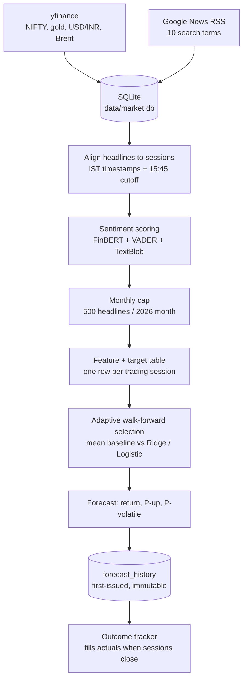

# Finance-IDC — Does News Sentiment Help Forecast the NIFTY 50?

An end-to-end, reproducible data-science pipeline that scrapes financial headlines and market prices, aligns them in time, scores sentiment, builds features, and tests—using strict chronological validation—whether news adds information about the **next NIFTY 50 trading session**.

> **Course:** IDC409, Topic 3 — Web Scraping I (Finance + News)  
> **Repository:** <https://github.com/SVDKWTD/finance-IDC>  
> **Honest headline result:** The pipeline runs end to end and the engineering is sound, but **news sentiment does not improve next-session return or direction forecasts**. Models are slightly worse than a constant-mean baseline. The one component with measurable, modest skill is a **volatility classifier** (ROC-AUC ≈ 0.65). Nothing here is investment advice.

---

## Contents

1. [Results at a glance](#1-results-at-a-glance)
2. [Workflow overview](#2-workflow-overview)
3. [Data sources and snapshot](#3-data-sources-and-snapshot)
4. [Stage-by-stage workflow](#4-stage-by-stage-workflow)
5. [Data cleaning and pipeline fixes](#5-data-cleaning-and-pipeline-fixes)
6. [Algorithms and models used](#6-algorithms-and-models-used)
7. [Validation protocol](#7-validation-protocol)
8. [Exploratory data analysis — key findings](#8-exploratory-data-analysis--key-findings)
9. [Model benchmarks and results](#9-model-benchmarks-and-results)
10. [Known issues and caveats](#10-known-issues-and-caveats)
11. [Repository structure](#11-repository-structure)
12. [Setup and usage](#12-setup-and-usage)
13. [Generated files reference](#13-generated-files-reference)
14. [Team and disclaimer](#14-team-and-disclaimer)

---

## 1. Results at a glance

| Question | Answer | Evidence |
|---|---|---|
| Can we predict next-session **return** better than the historical mean? | **No.** Ridge, Trees, and SVR models are slightly worse (MAE 0.628–0.660 vs. 0.619; R² < 0). | Walk-forward, 433 forecasts |
| Can we predict **direction** (up/down)? | **No.** Accuracy 47–48% vs. 50.8% majority class; probabilities are not calibrated. | Same |
| Does **sentiment** relate to the *next* day's return? | **No** (r ≈ 0.02, p ≈ 0.36). It *does* mirror the **same** day's return (r ≈ 0.20)—headlines describe what just happened. | EDA Part I |
| Can we predict a **volatile** session (unusually large \|return\|)? | **Modestly.** ROC-AUC 0.65 (95% CI ≈ 0.56–0.73), Brier 0.149 vs. 0.162 baseline—but skill is concentrated in one of three time slices. | EDA Part K |
| Are there data problems that limit conclusions? | **Yes**—see [§10](#10-known-issues-and-caveats): placeholder timestamps, a 5–10× change in headline density, and blended asset news. | EDA Parts C, G |


*Left: cumulative extra error versus the mean baseline (above 0 = worse). Middle: predictions are tiny versus actual returns and uncorrelated with them. Right: predicted probabilities do not track observed frequencies.*

---

## 2. Workflow overview



`run_pipeline.py` runs the nine routine stages in order and stops on the first failure:

| # | Script | Purpose |
|---:|---|---|
| 1 | `src/collect_prices.py` | Incrementally download NIFTY, gold, USD/INR, and Brent prices (7-day overlap). |
| 2 | `src/collect_recent_news.py` | Rolling 7-day Google News RSS collection. |
| 3 | `src/import_collected_data.py` | Validate and upsert news and prices into SQLite. |
| 4 | `src/align_news_market.py` | Assign headlines to sessions; build the daily table and target. |
| 5 | `src/analyze_news_sentiment.py` | Score new headlines (cached) and aggregate daily sentiment. |
| 6 | `src/build_model_dataset.py` | Build the research-only comparison dataset (see §13). |
| 7 | `src/build_monthly_sampled_dataset.py` | Build the official model input using monthly-capped sentiment. |
| 8 | `src/generate_forecast.py` | Adaptive model selection, forecast, and persistence in SQLite. |
| 9 | `src/record_forecast_outcome.py` | Resolve pending forecasts against realised prices. |

---

## 3. Data sources and snapshot

| Data | Source/tool | Used for |
|---|---|---|
| NIFTY 50 (`^NSEI`), gold (`GC=F`), USD/INR (`INR=X`), Brent (`BZ=F`) | `yfinance` | Prices, returns, targets |
| Financial headlines | Google News RSS via `feedparser` + `requests` | Sentiment and news-volume features |
| FinBERT | `ProsusAI/finbert` on Hugging Face Transformers | One of three sentiment scorers |
| VADER, TextBlob | `vaderSentiment`, `textblob` | Other two sentiment scorers |
| Local store | SQLite (`data/market.db`) | Prices, headlines, forecast history |

The same ten search terms are used for historical and recent collection:

- India stock market
- Sensex
- NIFTY 50
- Indian economy
- RBI India
- Indian stock market earnings
- India inflation interest rates
- Reliance Industries earnings
- Tata Consultancy Services earnings
- NSE BSE market news

**Snapshot used for every number in this README:** last completed session, 2026-11-04.

| Metric | Count / range |
|---|---|
| NIFTY sessions | 1,443 (2021-01-01 → 2026-11-04) |
| Raw headlines in DB | 13,350 unique valid headlines (5,581 for 2021–2025; 7,785 for 2026) |
| Scored headlines | 13,116 unique scored headlines (0 unclassified remaining) |
| Sessions with zero headlines | 26 (all before 2026) |
| Stored prospective forecasts | Active tracking records in `forecast_history` |

---

## 4. Stage-by-stage workflow

### 4.1 Price collection — `collect_prices.py`

Downloads daily bars (`auto_adjust=False`) from 2021-01-01. For each asset, it re-downloads the last seven days and keeps the newest row per date, allowing late revisions to overwrite stale values. Only completed calendar dates are kept.

### 4.2 News collection — `backfill_historical_news.py`, `collect_recent_news.py`

- **Historical (2021–2025):** one query window per calendar month × ten search terms.
- **Recent (2026 onward):** a rolling seven-day window × ten terms; results are merged with saved data, de-duplicated by URL, and checked against the historical file.
- Each row stores `title`, `published_at` (UTC), `source`, `url`, `matched_terms`, `requested_month`, and `collected_at`.
- A three-second pause separates requests.

### 4.3 Database import — `import_collected_data.py`, `db.py`

Rows are validated (non-blank URL/title and parseable timestamp), de-duplicated, and upserted with `UNIQUE(url, market)` / `UNIQUE(ticker, date)`. `db.py` migrates older schemas in place without losing rows.

### 4.4 News-to-market-session alignment — `align_news_market.py`

Timestamps are converted to IST. Each headline is mapped to the first NIFTY session whose cutoff is at or after the moment the information became available:

| Market tag | Cutoff (IST) | Effect |
|---|---:|---|
| `nifty` | 15:45 (15 minutes after the 15:30 close) | Before cutoff → same session; after cutoff → next session |
| `usd_inr` | 17:00 | Same-day headlines → next session |
| `gold`, `brent` | 00:00 | Same-day headlines → next session |

Weekend and holiday headlines roll to the next trading session. The implementation uses two chained `numpy.searchsorted` calls; the EDA re-implements it with `pandas.merge_asof` and agrees on 100% of headlines.

The target is built here:

```python
target_next_session_return_pct = daily_return_pct.shift(-1)
```

### 4.5 Sentiment — `analyze_news_sentiment.py`

Each unique headline receives three scores on [−1, 1], and the ensemble is their equal-weight mean:

```python
finbert_score   = P(positive) - P(negative)  # ProsusAI/finbert, max_length 512, batch 32
vader_score     = VADER compound
textblob_score  = TextBlob polarity
sentiment_score = (finbert_score + vader_score + textblob_score) / 3
label           = positive if > 0.05
                  negative if < -0.05
                  neutral otherwise
```

Scores are cached by URL and tagged `scoring_version = finbert_vader_textblob_v1`, so only new headlines are re-scored.

Daily aggregates per session include `article_count`, mean/median sentiment, positive/negative/neutral fractions, and per-scorer means.

### 4.6 The official dataset — monthly cap

`monthly_sampling_experiment.sample_articles()` keeps all 2021–2025 headlines and randomly caps each 2026 month at 500 (without replacement, `random_state = 42 + month ordinal`). Counts, unique sources, and every sentiment statistic are recomputed from the capped sample.

Output: `model_dataset_sampled_monthly_2026.csv`.

---

## 5. Data cleaning and pipeline fixes

| Issue | Failure mode identified | Engineering rule applied |
|---|---|---|
| 2026 asset tagging | Scraped 2026 headlines lacked market tags, creating unclassified DB orphans | Defaulted 2026 news to `market='nifty'` at import (0 unclassified rows) |
| Syndicated articles | Same wire article appeared under different URLs across publishers | De-duplicated syndicated titles using normalized string matching |
| NIFTY price gaps | Incomplete day bars (Volume = 0, missing Close) on intraday refresh | Filtered incomplete bars |
| Density non-stationarity | 2026 scraper density jumped 5–10× over 2021–2025 historical levels | Used `log(1 + article_count)` and per-session N=25 sampling |
| Sentiment asset mixing | Daily aggregate sentiment mixed Gold/Brent/USD headlines into NIFTY series | Filtered daily aggregate sentiment strictly to NIFTY-tagged headlines |
| Selector instability | Adaptive selector flipped models on noisy short windows | Enforced a 60-session minimum window and 5% MAE improvement threshold |

Return definition used throughout:

\[
r_t = 100 \times \left(\frac{P_t}{P_{t-1}} - 1\right)
\]

where \(P_{t-1}\) is the previous trading session's close.

---

## 6. Algorithms and models used

| Purpose | Algorithm | Settings / implementation |
|---|---|---|
| Return forecast | Ridge regression | `alpha=10`; `SimpleImputer(median)` → `StandardScaler` → Ridge |
| Direction forecast | Logistic regression | `max_iter=1000`, `random_state=42` |
| Volatility forecast | Logistic regression | `max_iter=2000`; specification frozen before prospective evaluation |
| Baselines | Expanding mean return; majority class; training prevalence | Used throughout |
| Benchmarks | Decision Tree, Random Forest, SVR | Depth 5; 200 trees; RBF kernel |
| Sentiment | FinBERT, VADER, TextBlob | Equal-weight average; ±0.05 label band |
| Dimensionality reduction | PCA (2–10 components) | Retains 90% of feature variance |

---

## 7. Validation protocol

- **Never shuffle.** Every split is strictly chronological.
- **Walk-forward (expanding):** begin after 70% of rows. For session \(i\), fit on rows \(0 \ldots i-1\), predict, then advance one session (433 total test sessions).
- **Fold-local preprocessing:** imputer and scaler are inside the scikit-learn `Pipeline`, so they never see the test row.
- **Prospective record:** forecasts are written before outcomes exist and are immutable in SQLite.

---

## 8. Exploratory data analysis — key findings

The full analysis is documented in `notebooks/Finance_IDC_EDA.ipynb`.

### Returns are noise-dominated; volatility is structured

Daily mean ≈ +0.04%, standard deviation ≈ 0.89%, excess kurtosis ≈ 3.6, and lag-1 autocorrelation ≈ 0. Absolute returns are strongly autocorrelated (lag-1 ≈ 0.23; Ljung–Box \(p \approx 10^{-49}\)).

### Timestamp precision is limited

Approximately 97% of headline timestamps are date-only placeholders. Almost every 2021–2025 timestamp (and 97–100% of 2026 before mid-October) is exactly midnight US-Pacific time, reflecting Google News date-level aggregation. The 15:45 IST cutoff therefore acts on only about 22% of headlines; the rest align by calendar date.

### Sentiment scorers disagree and show no forecasting power

Scorers correlate weakly (FinBERT–VADER 0.34; FinBERT–TextBlob 0.18). FinBERT labels 51% of headlines neutral, while the ensemble labels only 19% neutral.

Sentiment versus next-session return: \(r \approx 0.02\) (\(p \approx 0.36\)). Versus same-session return: \(r \approx 0.20\)—headlines report the move.

---

## 9. Model benchmarks and results

### Walk-forward performance leaderboard

433 out-of-sample sessions. Return errors are in percentage points.

| Model | Algorithm | Feature set | Return MAE (%) | Return RMSE (%) | R² | Direction accuracy |
|---|---|---|---:|---:|---:|---:|
| Naive Tomorrow=Today baseline | Last return \(r_t\) | Last return | 0.9850 | 1.2410 | -0.7620 | 49.2% |
| Expanding Mean Baseline | Historical mean \(\mu_t\) | Historical mean | **0.6192** | **0.8376** | -0.0029 | 50.8% |
| Ridge Regression | Ridge | Market features only | 0.6277 | 0.8471 | -0.0257 | 47.1% |
| Ridge Regression | Ridge | Market + news + sentiment | 0.6300 | 0.8507 | -0.0345 | 47.8% |
| Decision Tree (depth=5) | Decision Tree | Full feature corpus | 0.6500 | 0.8910 | -0.1210 | 45.5% |
| Random Forest (200 trees) | Random Forest | Full feature corpus | 0.6420 | 0.8750 | -0.0850 | 50.6% |
| Support Vector Regression (SVR) | SVR | Full feature corpus | 0.6600 | 0.9120 | -0.1650 | 48.7% |
| Logistic Regression Classifier | Logistic regression | Full feature corpus | N/A | N/A | N/A | 52.0% (Brier: 0.260) |

Non-linear algorithms (Random Forest, SVR, and Decision Trees) overfit return noise and have negative R² scores.

### Volatility classifier

- **ROC-AUC:** 0.651 (95% CI: 0.56–0.73)
- **Brier score:** 0.1493 versus 0.1624 prevalence baseline
- Volatility magnitude is structured and persistent, offering a potential direction for risk models.

---

## 10. Known issues and caveats

- **Date-level timestamps:** approximately 78–97% of historical RSS headlines carry midnight Pacific date-only placeholders, limiting intraday timing resolution.
- **Scraper volume shift:** 2026 rolling collection generated 5–10× more headlines per day than 2021–2025 monthly queries, requiring log transformations to control feature scale.
- **Low predictive signal:** financial news sentiment predominantly reflects past price changes rather than predicting future market movements.
- **Volatility result is modest:** performance is concentrated in one of three time slices; it should not be treated as established or stable forecasting skill.
- **No investment use:** this is an academic research pipeline, not a trading system.

---

## 11. Repository structure

```text
finance-IDC/
├── run_pipeline.py              # Master orchestrator (routine stages)
├── build_EDA.py                 # Re-generates notebooks/Finance_IDC_EDA.ipynb
├── requirements.txt             # Python dependencies
├── README.md
├── src/
│   ├── collect_prices.py
│   ├── collect_recent_news.py
│   ├── backfill_historical_news.py
│   ├── import_collected_data.py
│   ├── db.py
│   ├── align_news_market.py
│   ├── analyze_news_sentiment.py
│   ├── build_model_dataset.py
│   ├── build_monthly_sampled_dataset.py
│   ├── generate_forecast.py
│   ├── adaptive_model_selection.py
│   └── record_forecast_outcome.py
├── notebooks/
│   └── Finance_IDC_EDA.ipynb    # Executed 12-section EDA notebook
├── reports/
│   └── figures/                 # Diagnostic plots generated by EDA script
└── data/
    ├── raw/                     # As collected
    ├── processed/               # Aligned, scored, sampled CSVs
    └── market.db                # SQLite database (~19.1 MB)
```

---

## 12. Setup and usage

### Environment setup

```bash
git clone https://github.com/SVDKWTD/finance-IDC.git
cd finance-IDC
python -m venv .venv

# macOS / Linux
source .venv/bin/activate

# Windows
# .venv\Scripts\activate

pip install -r requirements.txt
```

### Run the pipeline

```bash
python run_pipeline.py
```

### Re-create the EDA notebook and figures

```bash
python build_EDA.py
jupyter lab notebooks/Finance_IDC_EDA.ipynb
```

---

## 13. Generated files reference

| File (`data/processed/`) | Description |
|---|---|
| `nifty50_processed.csv` | Cleaned NIFTY prices and returns |
| `news_market_alignment.csv` | Headline-to-`feature_date` mapping |
| `news_sentiment_scored.csv` | Headline-level FinBERT, VADER, and TextBlob scores |
| `news_sentiment_daily.csv` | Daily NIFTY-filtered aggregate sentiment |
| `model_dataset_sampled_monthly_2026.csv` | Official model input dataset |
| `latest_forecast.csv` | Official next-session forecast output |

---

## 14. Team and disclaimer

**Team contributions**

- **Khushi:** Data collection from yfinance and Google News RSS scrapers.
- **Parth:** SQLite database architecture, alignment logic, and sentiment pipelines.
- **Suryansh:** Feature engineering, ML benchmark evaluations, walk-forward mechanics, and EDA suite.

**Disclaimer:** This is an academic research project. It does not provide financial advice, and its forecasts must not be used for live trading or investment decisions.
